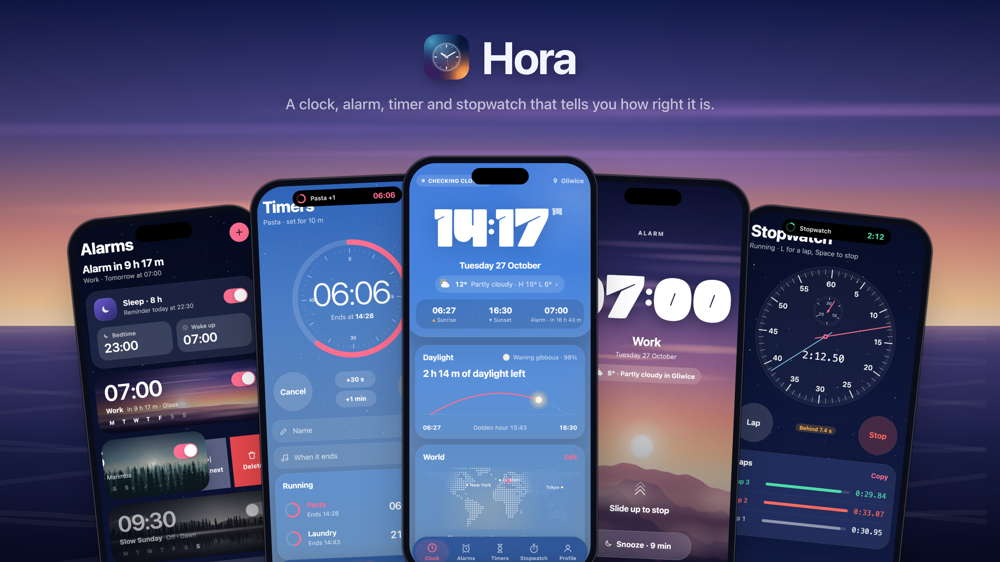
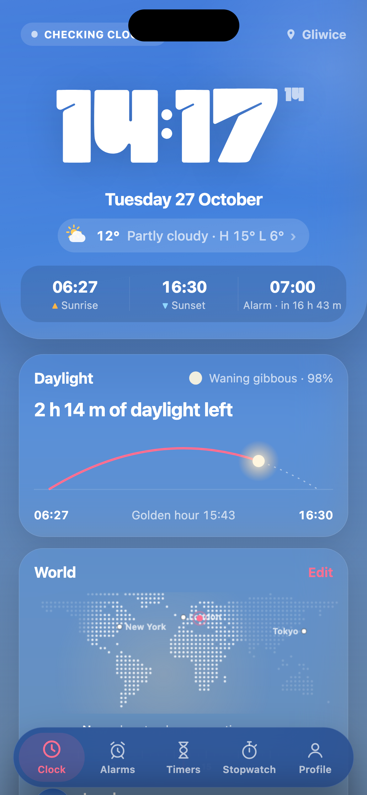
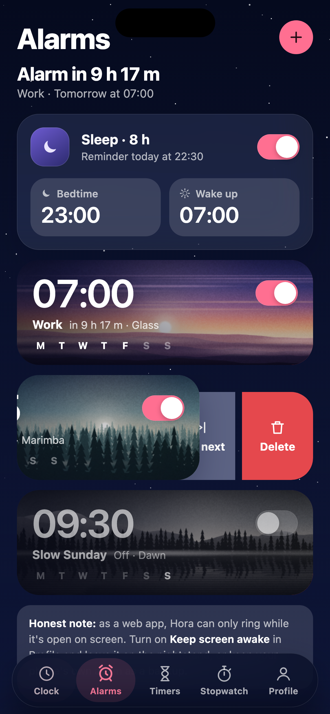
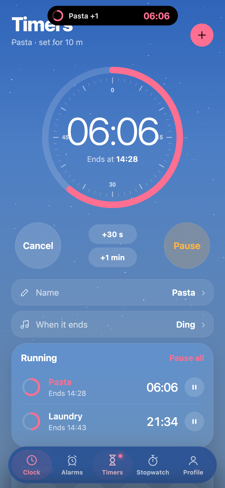
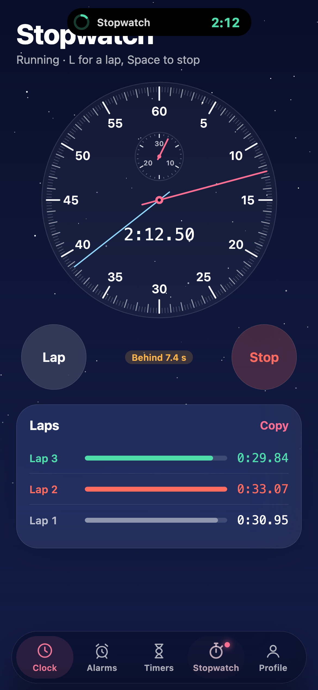
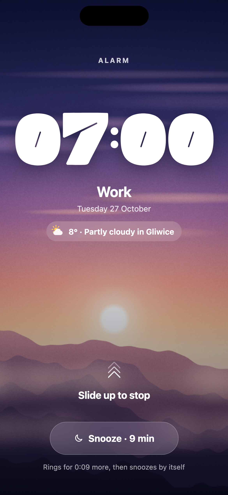

# Hora

<b>A clock, alarm, timer and stopwatch that tells you how right it is.</b>

 

No app store, no account, no ads. Get the **Android app**, or use Hora in any phone's browser. Everything stays on your phone.

---

☕️ You can support me and Buy me a coffee ☕️

[https://buycoffee.to/szebastian](https://buycoffee.to/szebastian)

---

## What's inside

- **🕰 Clock:** the background is the real sky over your city right now. A quiet weather line sits under the date; tap it for the next 12 hours and when rain is likely. Tap the time to switch to the analog face. The **LIVE** badge checks your clock against an internet clock and shows how far off it is.
- **🌍 World:** add any city, town or village in the world. A dotted map shows where it's day and night, and dragging the time ruler moves the night with it, so you can plan a call across time zones. Each city shows a small clock tinted with its own sky, and whether people there are working or asleep.
- **⏰ Alarms:** each alarm gets its own moving wake-up scene (19 of them, from Misty pines and Alpine lake to Aurora and Snowfall, or your own photo or video), its own sound (twelve built in, or any song on your phone), a vibration pattern, any snooze length from 1 to 60 minutes, and a choice of what happens if you don't answer. Swipe an alarm left to skip its next ring or delete it. Slide up to stop, tap to snooze. In the Android app, the next alarm shows in your notifications two hours ahead, so you can dismiss it before it rings.
- **🌙 Sleep:** one dial sets your bedtime and wake-up. Hora nudges you gently before bed, suggests bedtimes that wake you between sleep cycles, and wakes you with its own scene and sound, or your own song.
- **⏳ Timers:** drag the ring like a kitchen timer, tap the time for exact hours, minutes and seconds, or tap a preset. Pick a built-in sound or your own song for when they end. Name timers, edit the presets, run several at once and pause them all together. Add 30 seconds or a minute to a running timer with one tap. In the Android app a running timer counts down in your phone's status bar and on the lock screen, with its progress bar and +30 s and +1 min buttons, even with Hora closed.
- **⏱ Stopwatch:** an analog dial with a minutes hand, or big digits. Laps show as bars, with your fastest and slowest marked and whether you're ahead of or behind your average.
- **🎨 Profile:** five backgrounds, six accent colours, three clock styles, 24-hour time and more.
- **🗣 Google Assistant (Android app):** "Hey Google, set an alarm for 7" or "set a timer for 10 minutes" can go to Hora.

## Screens

  
  
  
  
  

Clock · Alarms and sleep · Timers · Stopwatch · Wake-up screen

## Getting started

### Android app (recommended)
1. Open **[Releases](https://github.com/Szebastian31/hora/releases/latest)** on your phone and download **Hora_v….apk**.
2. Open the file. If Android asks, allow your browser to **install unknown apps**.
3. Open Hora and allow **notifications**. Then go to **Profile → Alarms on this phone** and make sure every row says **On**.

Updating: download the new APK and install it over the old one. Your alarms stay.

### iPhone or any browser
1. Open **[szebastian31.github.io/hora](https://szebastian31.github.io/hora/)**.
2. **iPhone (Safari):** tap **Share**, then **Add to Home Screen**. **Android (Chrome):** tap **⋮**, then **Install app**.

## An honest note about alarms

- **Android app:** alarms and timers ring with the sound you chose even when Hora is closed, the phone is locked, or you're using another app. Android plays the sound itself, so Hora doesn't need to open. On the lock screen you get Hora's wake-up screen; while you're using the phone a pop-up shows **Stop** and **Snooze** (or **+1 min** for timers). If the sound can't play for any reason, the phone's own alarm sound takes over, so an alarm is never silent. On Oppo, OnePlus and Xiaomi phones, also allow Hora to run in the background (Profile shows how), or the system may stop it overnight.
- **Status bar timer:** on Android 16 and newer a running timer or stopwatch can show as a chip in the status bar. Older Android versions show it as a notification instead.
- **Browser version:** alarms only ring while Hora is open on screen. Turn on **Keep screen awake** in Profile, or keep your phone's own alarm as a backup.

## Privacy

Everything stays on your phone. Your alarms, photos, videos and sounds are saved on your device only and never uploaded. The only things Hora downloads are the time check, the weather for your city and city names when you search, from Open-Meteo, without an account.

## Questions or ideas?

Found a bug? [Open an issue](https://github.com/Szebastian31/hora/issues) and describe what happened, which phone you use and which browser.

---

_Hora is Latin for "hour". It's a sibling to Consensus Weather, Fidelis, Vestis, Caelum, Kalendae and Augur._

For developers

The interface is plain HTML, CSS and JavaScript, hosted on GitHub Pages. The Android app (`app/`) bundles those same files into a native shell that schedules alarms with Android's AlarmManager. GitHub Actions builds the APK on every push and publishes it as a release.

| File | What it does |
| --- | --- |
| `index.html` | Layout |
| `style.css` | Styles |
| `app.js` | Clock, weather, world, alarms, sleep, timers, stopwatch, sounds, live pill |
| `scenes.js` | Animated wake-up scenes and saving your own media |
| `manifest.webmanifest`, `sw.js` | Home-screen install, shortcuts and offline cache |
| `icons/` | App icons (`icon.svg`, plus the PNGs made from it) |
| `tools/screenshots.sh` | Makes everything in `screenshots/` from the real app with made-up alarms and timers |
| `app/` | Android app: alarm scheduling, ringing from Android with Stop and Snooze, upcoming-alarm notifications, the backup alarm sound, the status bar timer, Assistant intents |
| `.github/workflows/build.yml` | Builds the APK and publishes it as a release |

Built with compileSdk and targetSdk 36, Android Gradle Plugin 8.13 and Gradle 8.13. After changing any file, bump `VERSION` in `sw.js` so installed web copies update, and `versionName` + `versionCode` in `app/build.gradle` for a new APK release.

**Screenshots:** `tools/screenshots.sh` (or `tools/screenshots.sh dusk` for another background). It needs Google Chrome and touches none of your own data. Without it, `index.html?demo=clock` shows the same made-up alarms and timers in any browser (`demo=alarms`, `timer`, `stopwatch` or `ring`).

