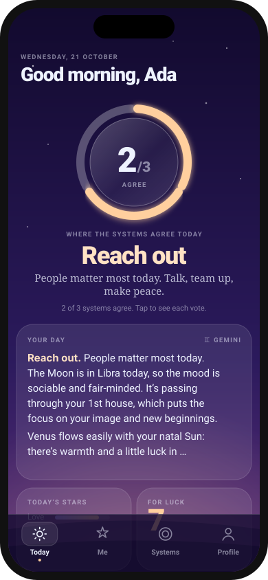
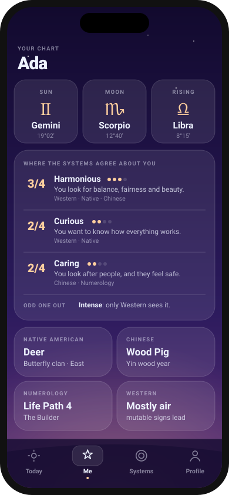
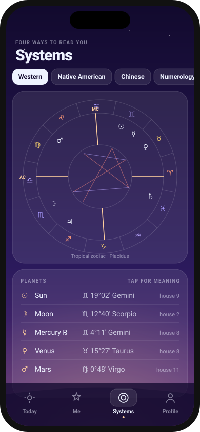
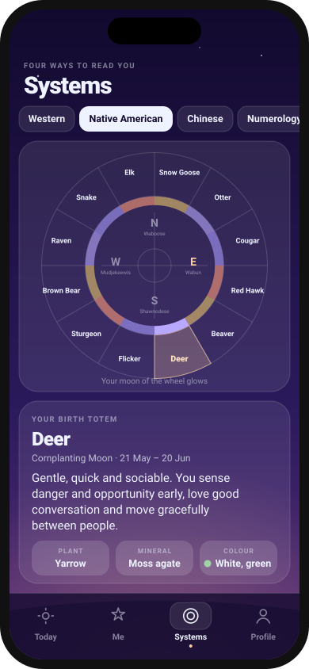

# Augur

<b>Your stars, six ways, and where they agree.</b>

 

No app store, no account, no ads. Get the **Android app**, or use Augur in any phone's browser.

Today · Me · Birth chart · Medicine Wheel

---

☕️ You can support me and Buy me a coffee ☕️

https://buycoffee.to/szebastian

---

## Getting started

### Android app (recommended)

1. Open **[Releases](https://github.com/Szebastian31/augur/releases/latest)** on your phone and download **Augur_v….apk**.
2. Open the file. If Android asks, allow your browser to **install unknown apps**.
3. Open Augur and fill in your birth details once.

### iPhone or any browser

1. Open **[szebastian31.github.io/augur](https://szebastian31.github.io/augur/)**.
2. **iPhone (Safari):** tap **Share**, then **Add to Home Screen**. **Android (Chrome):** tap **⋮**, then **Install app**.

## What's inside

- **☀️ Today:** a friendly reading built from the real sky today measured against *your* chart, not a generic one for your sign: how the day feels, what it's good for and what to go easy on. Star ratings for love, work, energy and mood, a lucky colour and number, and a quote of the day.
- **⚖️ Where the systems agree:** like Consensus Weather averaging seven forecast models, Western (the Moon in your houses), Chinese (today's day pillar against your Day Master), Numerology (your Personal Day) and Mayan (today's day sign) each vote for today's tone, such as *Reach out* or *Slow down*. The ring shows how many agree, and tapping it shows why.
- **📅 Week:** the week ahead, day by day. Its overall energy (building, winding down or steady, and its best day), the moments worth knowing (new and full Moons, Mercury turning, planets changing sign), and how it looks for love, work, money, health, home, friends and growth, each with its best day. Tap any day to read it in full.
- **✦ Me:** your Sun, Moon and rising sign, the traits the six systems agree on (and how many of them do), and the one where they disagree.
- **◎ Systems:**
  - **Western:** chart wheel, planets in signs and houses, aspects, element balance. Placidus, Whole Sign, Equal or Porphyry houses.
  - **Native American:** the Medicine Wheel. Your birth totem and its moon, plant, mineral and colour, your elemental clan (Turtle, Frog, Thunderbird or Butterfly) and your spirit keeper direction.
  - **Chinese:** your zodiac animal and element (by Lunar New Year), the Four Pillars (Ba Zi), your Day Master, element balance, best matches and clashes.
  - **Numerology:** Life Path, Expression, Soul Urge, Personality, Birthday, Maturity, and your Personal Year, Month and Day.
  - **Egyptian:** your god of the Egyptian zodiac (one of twelve, from Nile to Sekhmet) in a cartouche, with its gift, its shadow, your days and best matches.
  - **Mayan:** your day sign (nawal) and number from the 260-day sacred calendar, in the traditional K'iche' count first, and in Dreamspell with your Kin and its oracle (guide, support, challenge and hidden power).
- **🎨 Profile:** three looks (Night, Dawn, Paper), house system, language, and deleting all your data.
- **🌍 33 languages,** the same set as Consensus Weather: English, Polish, German, Ukrainian, Spanish, French, Russian, Chinese, Japanese, Portuguese, Dutch, Italian, Hindi, Arabic, Greek, Czech, Swedish, Korean, Indonesian, Bengali, Turkish, Telugu, Romanian, Hungarian, Finnish, Norwegian, Slovak, Swahili, Persian, Danish, Thai, Vietnamese and Bulgarian. Augur opens in your phone's language and falls back to English; you can change it in Profile. Arabic and Persian read right to left.

## An honest note about accuracy

- **Planet positions** are calculated on your phone for the minute you were born, accurate to well under a degree (the Moon to about 0.02°). That's plenty for signs, houses and aspects.
- **Your birth time is the weak spot.** The rising sign changes about every 2 hours. If yours is close to changing, Augur says which sign it would be if your recorded time is a few minutes off. Choose *Roughly* and it lists every rising sign possible in that range. Don't know your time? It shows which signs rose during your birthday.
- **Summer time and old time zones** come from your phone's built-in time-zone history, so a birth in 1970s Poland gets the clock rules that applied that day.
- **The Medicine Wheel** is the one published by Sun Bear and Wabun Wind in 1980, the version most "Native American zodiac" sites use. It draws on Anishinaabe teachings but is a modern system, not the tradition of any one Nation. Your totem follows the Sun's position at birth, so it often agrees with your Western Sun sign.
- **The Egyptian zodiac** is a modern system that spread online in the 2000s. There is no evidence the ancient Egyptians used it; Augur says so on its page.
- **The Mayan calendar** follows the count K'iche' daykeepers in Guatemala still keep (the standard GMT correlation, so 21 December 2012 is 4 Ajpu). Dreamspell, created in 1987, skips 29 February and counts differently, so it usually gives a different day; Augur shows both and labels which is which.
- **Lunar New Year** is worked out from real new moons. It's right for nearly every year; very rare leap-month years (the next is 2033) can be a month off.

## Privacy

Everything stays on your phone. Your name, birth date, time and place are saved on your device only and used for nothing except your readings. The only thing Augur sends anywhere is the town you type when searching for your birthplace, which goes to the free [Open-Meteo place search](https://open-meteo.com/en/docs/geocoding-api). Without internet you can type the coordinates yourself.

## Questions or ideas?

Found a bug? [Open an issue](https://github.com/Szebastian31/augur/issues) and describe what happened, which phone you use and which browser.

---

_Augur is Latin for a Roman priest who read the signs in the sky. It's a sibling to Consensus Weather, Fidelis, Vestis, Caelum and Hora._

For developers

The interface is plain HTML, CSS and JavaScript, hosted on GitHub Pages. The Android app (`app/`) bundles those same files into a native WebView shell that adds the system share sheet and vibration. GitHub Actions builds the APK on every push and publishes it as a release.

| File | What it does |
| --- | --- |
| `index.html` | Layout, styles and the first-open form |
| `astro.js` | Astronomy: Sun, Moon, planets to Pluto, lunar node, ΔT, sidereal time (based on Caelum's) |
| `chart.js` | Birth time → UTC with time-zone history, Ascendant/MC, houses, aspects, rising-sign certainty |
| `native.js` | Medicine Wheel totems, clans and spirit keepers |
| `chinese.js` | Lunar New Year from new moons, zodiac animal, Four Pillars, five elements |
| `numerology.js` | Pythagorean numbers and personal cycles |
| `egyptian.js` | The twelve gods of the Egyptian zodiac and their dates |
| `mayan.js` | The 260-day count: traditional K'iche' day signs and numbers, Dreamspell Kin and oracle |
| `consensus.js` | Where the systems agree, about you and about today |
| `daily.js` | A day's transits, the reading and the ratings for every area of life |
| `week.js` | The week ahead: its shape, best and hardest days, moments and every area of life |
| `texts.js`, `quotes.js` | Everything Augur says, and a quote for each of the 366 days of the year |
| `i18n.js`, `i18n/` | Language picking (saved choice, then phone language, then English) and one file per language |
| `ui.js`, `draw.js`, `systems.js`, `app.js` | Screens, chart drawings, settings and navigation |
| `manifest.webmanifest`, `sw.js` | Home-screen install and offline cache |
| `icons/` | App icon: `icon.png` (1024 px) is the master, the other sizes are made from it with `sips` |
| `screenshots/` | The mockups above |
| `app/` | Android app: WebView shell, share sheet, vibration, launcher icon |
| `.github/workflows/build.yml` | Builds the APK and publishes it as a release |

After changing any file, bump `VERSION` in `sw.js` so installed web copies update, and `versionName` + `versionCode` in `app/build.gradle` for a new APK release. If you add a `.js` file, add it to `index.html`, `sw.js` and the `copyWebApp` list in `app/build.gradle`. A new text goes into `i18n/en.js` first; other languages show the English until they get their own line.

