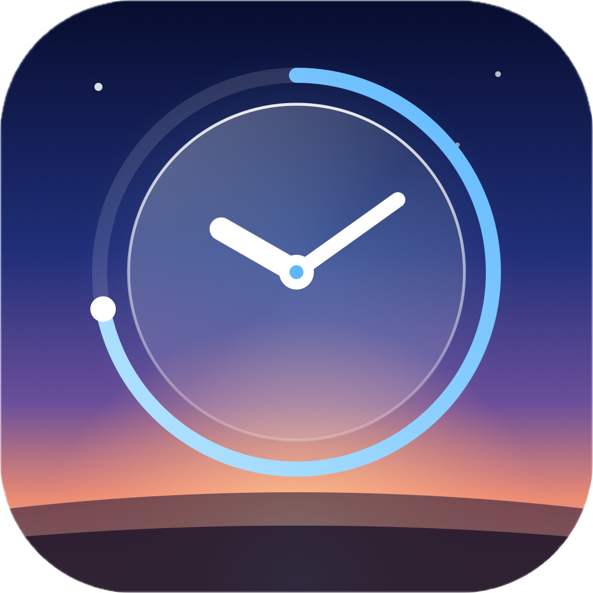
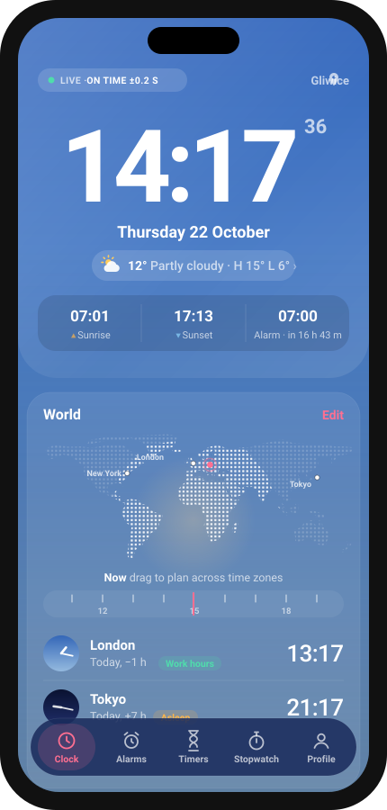
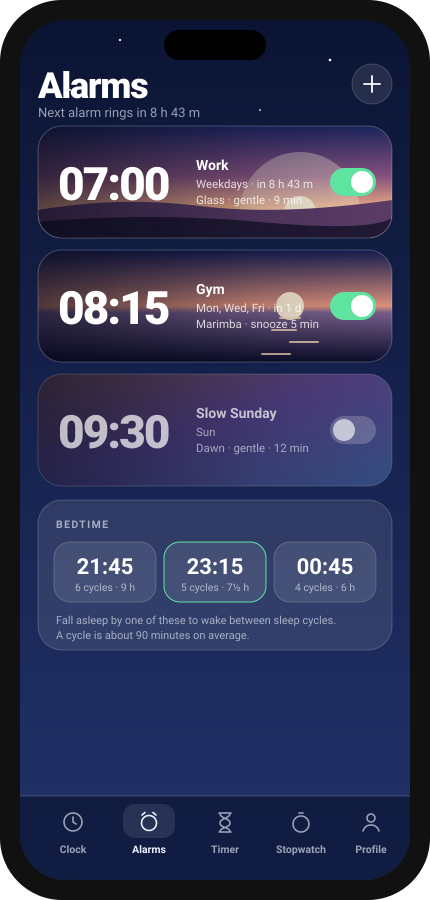
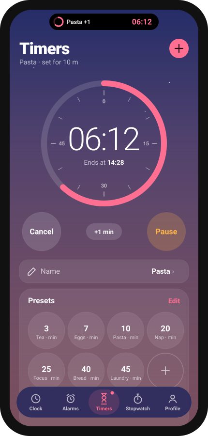
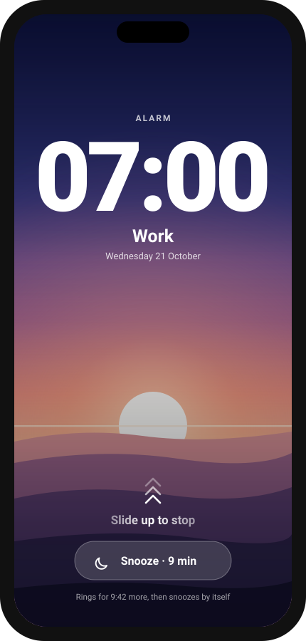
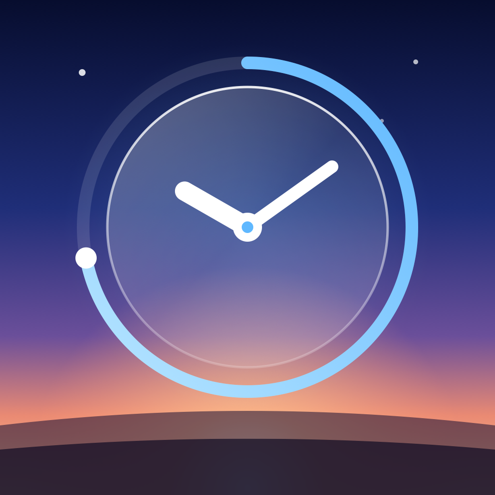

# Hora

<b>A clock, alarm, timer and stopwatch that tells you how right it is.</b>

 

No app store, no account, no ads. Get the **Android app**, or use Hora in any phone's browser.

  
  
  
  

Clock · Alarms · Timer with the live pill · Wake-up screen

---

## Getting started

### Android app (recommended)
1. Open **[Releases](https://github.com/Szebastian31/hora/releases/latest)** on your phone and download **Hora_v….apk**.
2. Open the file. If Android asks, allow your browser to **install unknown apps**.
3. Open Hora and allow **notifications**. Then go to **Profile → Alarms on this phone** and make sure every row says **On**.

### iPhone or any browser
1. Open **[szebastian31.github.io/hora](https://szebastian31.github.io/hora/)**.
2. **iPhone (Safari):** tap **Share**, then **Add to Home Screen**. **Android (Chrome):** tap **⋮**, then **Install app**.

## What's inside

- **🕰 Clock:** the background is the real sky over your city right now. Tap the time to switch to analog. The **LIVE** badge checks your clock against an internet clock and shows how far off it is.
- **🌍 World:** add cities and drag the time ruler to see what time it will be everywhere, handy for planning calls.
- **⏰ Alarms:** each alarm gets its own moving wake-up scene (or your own photo or video), its own sound (ten built in, or your own file), any snooze length from 1 to 60 minutes, and a choice of what happens if you don't answer. Slide up to stop, tap to snooze.
- **⏳ Timer:** drag the ring like a kitchen timer or tap a preset like Tea or Focus. Run several at once. A live pill at the top shows the countdown wherever you are in the app.
- **⏱ Stopwatch:** laps with your fastest and slowest marked, and whether you're ahead of or behind your average.
- **🎨 Profile:** five skins, three clock styles, 24-hour time and more.
- **🗣 Google Assistant (Android app):** "Hey Google, set an alarm for 7" or "set a timer for 10 minutes" can go to Hora.

## An honest note about alarms

- **Android app:** alarms and timers ring even when Hora is closed or the phone is locked. On Oppo, OnePlus and Xiaomi phones, also allow Hora to run in the background (Profile shows how), or the system may stop it overnight.
- **Browser version:** alarms only ring while Hora is open on screen. Turn on **Keep screen awake** in Profile, or keep your phone's own alarm as a backup.

## Privacy

Everything stays on your phone. Your alarms, photos, videos and sounds are saved on your device only and never uploaded.

## Questions or ideas?

Found a bug? [Open an issue](https://github.com/Szebastian31/hora/issues) and describe what happened, which phone you use and which browser.

---

_Hora is Latin for "hour". It's a sibling to Consensus Weather, Fidelis, Vestis and Caelum._

For developers

The interface is plain HTML, CSS and JavaScript, hosted on GitHub Pages. The Android app (`app/`) bundles those same files into a native shell that schedules alarms with Android's AlarmManager. GitHub Actions builds the APK on every push.

| File | What it does |
| --- | --- |
| `index.html` | Layout and styles |
| `app.js` | Clock, alarms, timers, stopwatch, sounds, live pill |
| `scenes.js` | Animated wake-up scenes and saving your own media |
| `manifest.webmanifest`, `sw.js` | Home-screen install, shortcuts and offline cache |
| `icons/` | App icons |
| `icons.html` | Page that exports the PNG icons |
| `app/` | Android app: alarm scheduling, lock-screen ringing, Assistant intents |
| `.github/workflows/build.yml` | Builds the APK and publishes it as a release |

After changing any file, bump `VERSION` in `sw.js` so installed web copies update, and `versionName` + `versionCode` in `app/build.gradle` for a new APK release.

